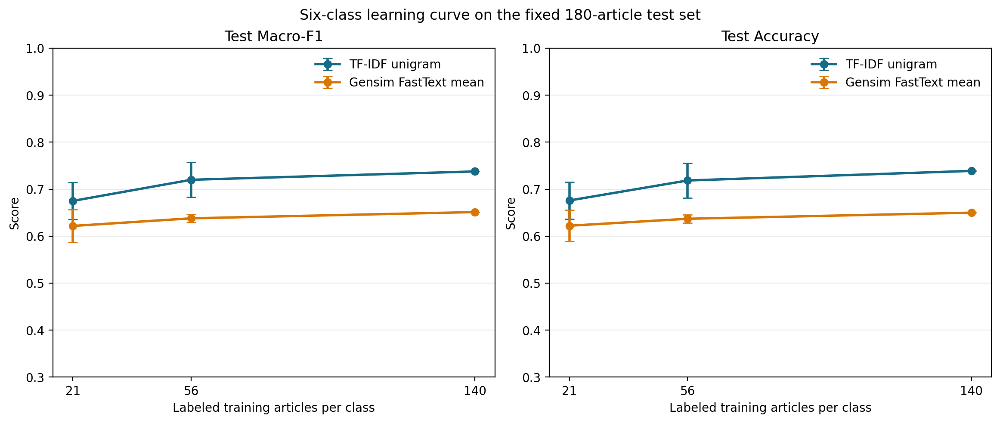

# 外部子词词向量能否提升小样本新闻分类？——基于 Gensim FastText 的弱标签实验

## 摘要

本实验考察：在少量标注的新闻分类任务中，使用外部无标签语料训练的 Gensim FastText 子词表示，能否将更广的词表外覆盖转化为分类收益。词向量仅在 LR-Sum 简体中文训练语料上训练；分类语料为 1998 年上半年的课程新闻语料，类别由标题关键词规则产生。比较 TF-IDF、冻结 Word2Vec/FastText 向量均值，以及官方 fastText 随机或预训练初始化后的监督分类。六类训练正文中，Gensim 显式词表覆盖 25.19% 的词类型和 78.54% 的词频；但六类测试 Macro-F1 中，冻结 FastText 均值为 0.6513，低于 Word2Vec 均值的 0.6749 和 TF-IDF 的 0.7378。固定测试集上的三种训练子集抽样显示，TF-IDF 的 Macro-F1 从每类 21 篇时的 0.6751 升至 140 篇时的 0.7378，FastText 均值从 0.6218 升至 0.6513。官方 fastText 预训练初始化在六类任务达到 0.7627，但相对随机初始化的收益随类别任务而变。结果表明，可为表外词生成向量并不等同于获得适合分类的语义特征；本实验结论适用于当前标题关键词弱标签及固定测试样本。

## 1. 研究问题与动机

传统词向量通常为显式词表中的每个词保存独立表示，未见词无法直接查表。FastText 以字符 n-gram 组合词表示，使训练中未出现的词也可能通过已学习的子词向量得到表示 [2, 4]。这一机制解决的是向量可查询性；在下游分类中，子词片段是否携带与目标标签相关的信息，还取决于预训练语料、分词方式、文档表示和分类目标。

本实验围绕一个问题展开：在每类只有 21–140 篇有标签训练文章的条件下，LR-Sum 上训练的 Gensim FastText 是否优于词级 Word2Vec 及 TF-IDF？同时，将冻结词向量均值与以同一词向量初始化、再由标签监督训练的官方 fastText 区分开来。前者检验固定外部表示作为文档特征的表现；后者检验包含监督参数更新和词 bigram 的分类器在本数据上的结果。两者结构不同，差异不能单独归因于预训练初始化。

## 2. 数据与标签构造

### 2.1 外部表示学习语料

词向量训练数据取自 LR-Sum 的简体中文 `cmn_s` 配置，仅使用 `train` split 的正文 `text`。LR-Sum 是面向多种语言摘要研究的新闻数据集 [1]。原始 483 篇记录经 Unicode 规范化、正文清理和重复文本去重后保留 482 篇，共 359,302 个 jieba 分词 token。训练过程不读取标题、摘要、数据集标签或验证、测试分片。来源数据采用 CC BY 4.0 许可。

### 2.2 分类语料与弱标签

分类文章来自课程提供的 1998 年 1–6 月《人民日报》新闻语料。文本按 GB18030 严格解码，依文章 ID 合并段落并清理正文；解码失败、正文缺失、重复或记录冲突的文章按既定规则排除，最终得到 16,722 篇正文唯一的有效文章。

标题按预先设定的关键词表生成六类弱标签：体育、经济、文化、国际、政治和社会。标题未命中类别、命中多个类别，或正文短于 80 个源词的文章不进入候选集。每类候选中按固定哈希顺序各取 200 篇，再按类别拆分为训练 140 篇、验证 30 篇、测试 30 篇。表 1 给出各类候选与样本规模；图 1 展示总体筛选及六类拆分。

| 类别 | 单类关键词候选 | 选取 | 训练 | 验证 | 测试 |
|---|---:|---:|---:|---:|---:|
| 体育 | 277 | 200 | 140 | 30 | 30 |
| 经济 | 1,132 | 200 | 140 | 30 | 30 |
| 文化 | 371 | 200 | 140 | 30 | 30 |
| 国际 | 729 | 200 | 140 | 30 | 30 |
| 政治 | 556 | 200 | 140 | 30 | 30 |
| 社会 | 797 | 200 | 140 | 30 | 30 |

**表 1.** 六类弱标签候选及固定样本划分。候选数是标题命中恰好一个类别关键词组、且正文满足长度要求的文章数。

**图 1.** 左图为文章 ID 组、有效且去重后的文章、单类关键词候选及最终选样规模；右图为六类各 200 篇样本的训练、验证与测试数量。类别平衡来自选样规则，不代表原始新闻语料的类别比例。

2、4、6 类任务分别使用体育和经济，加入文化和国际，再加入政治和社会，形成嵌套分类任务。分类器只读取正文前 500 个源词，不输入标题。测试集中 173/180 篇正文含有其标签对应的至少一个标题关键词；训练集和验证集相应比例分别为 798/840 和 172/180。此重合反映了弱标签规则与分类输入之间的直接词面线索，后续分数应按这一标签构造理解。

## 3. 方法与实验设置

### 3.1 词表示

Word2Vec 与 Gensim FastText 均采用 Skip-gram、100 维向量、窗口 5、`min_count=3`、10 轮训练、单 worker 和随机种子 42。FastText 使用长度 2–4 的字符 n-gram 和 100,000 个哈希桶。两个模型均在上述 LR-Sum 正文上训练。FastText 对显式词表外的词，可根据其字符 n-gram 生成向量；该机制保证的是可能得到一个数值表示，不是该表示对当前分类标签有效 [2, 4]。

Skip-gram 与连续词袋模型（CBOW）都通过局部上下文学习词向量。设序列长度为 \(T\)，\(w_t\) 为其中第 \(t\) 个词，\(C_t\) 为其上下文词集合，\(V\) 为训练词表，\(\mathbf v_w\) 和 \(\mathbf u_w\) 分别表示输入、输出向量。给定表示 \(\mathbf h\)，全词表 softmax 及两种训练目标可写为：

$$
\begin{aligned}
p(w_o\mid \mathbf h)
&=\frac{\exp(\mathbf u_{w_o}^{\top}\mathbf h)}
{\sum_{w\in V}\exp(\mathbf u_w^{\top}\mathbf h)},\\
\mathcal L_{\mathrm{SG}}
&=-\sum_{t=1}^{T}\sum_{w_o\in C_t}\log p(w_o\mid \mathbf v_{w_t}),\\
\mathbf h_t^{\mathrm{CBOW}}
&=\frac{1}{|C_t|}\sum_{c\in C_t}\mathbf v_c,\qquad
\mathcal L_{\mathrm{CBOW}}
=-\sum_{t=1}^{T}\log p(w_t\mid\mathbf h_t^{\mathrm{CBOW}}).
\end{aligned}
$$

Skip-gram 从中心词预测窗口内的上下文词，CBOW 则汇总上下文表示以预测中心词 [5]。其中 \(w_o\in C_t\) 表示真实上下文词。本实验采用 Skip-gram 目标；两者的差别在于用于预测的条件表示分别来自中心词和上下文词。

负采样通过真实上下文词与噪声词之间的对比目标，避免对完整词表逐项计算归一化概率。对中心词 \(w_t\)、真实上下文词 \(w_o\) 和 \(K\) 个噪声词，其单个训练对的损失为：

$$
\begin{aligned}
\ell_{\mathrm{NS}}
&=-\log \sigma(\mathbf u_{w_o}^{\top}\mathbf v_{w_t})
-\sum_{i=1}^{K}\log \sigma(-\mathbf u_{n_i}^{\top}\mathbf v_{w_t}),\\
n_i&\sim P_n,\qquad
P_n(w)=\frac{f(w)^{0.75}}{\sum_{w'\in V}f(w')^{0.75}}.
\end{aligned}
$$

其中 \(\sigma\) 为 sigmoid 函数，\(f(w)\) 为无标签训练语料中的词频。本实验对每个正样本抽取 \(K=5\) 个噪声词，并按 unigram 频率的 \(0.75\) 次幂构造噪声分布；该目标将完整词表上的归一化计算替换为少量正、负样本的对比学习 [4, 6]。

Gensim FastText 在相同 Skip-gram 目标上为字符 n-gram 学习共享的子词向量。原始方法将词表示构造为其字符 n-gram 向量之和，使包含已学习子词片段的未见词也可能获得表示 [2]。对于词表外词，可用子词桶向量的均值表示为：

$$
\mathbf v_{\mathrm{OOV}}(w)
=\frac{1}{|G_{2:4}(w)|}
\sum_{g\in G_{2:4}(w)}\mathbf z_{h(g)}.
$$

其中 \(G_{2:4}(w)\) 为从词 \(w\) 提取的 2–4 字符 n-gram 多重集，\(h(g)\) 将 n-gram 映射到哈希桶，\(\mathbf z_{h(g)}\) 为对应的桶向量；没有可用 n-gram 时，该表示为零向量。由此，部分词表外词也可纳入文档均值表示，扩大可查询词的范围，但不保证子词组合与分类标签相关 [4]。

### 3.2 分类方法

| 方法 | 文档特征与分类训练 |
|---|---|
| TF-IDF + LR | 正文 unigram、sublinear TF-IDF；训练逻辑回归。 |
| Word2Vec 均值 + LR | 正文词向量逐词求均值；仅在训练集拟合 StandardScaler，再训练逻辑回归。 |
| Gensim FastText 均值 + LR | 同样对词向量取均值并使用训练集拟合的 StandardScaler 与逻辑回归；可为部分表外词生成向量。 |
| 官方 fastText，随机初始化 | `train_supervised` 训练 softmax 分类器及文本表示，使用词 unigram 与 bigram。 |
| 官方 fastText，预训练初始化 | 用 Gensim FastText 导出的显式词向量初始化，再用相同监督设置更新分类器和表示。 |

两种均值特征的逻辑回归使用 `C=1`、`max_iter=2000`。官方 fastText 使用 100 维表示、学习率 0.5、`wordNgrams=2`，关闭字符 n-gram，并使用单线程、随机种子 42。预训练 `.vec` 包含六类完整训练正文词表与 Gensim 显式词表的交集，共 5,950 个词；不含合成的表外向量。该共享导出文件用于 2、4、6 类任务，因此较小任务可读取来自其他类别六类训练文章的词项向量，但不含验证或测试文本词项。fastText 监督分类采用词与 n-gram 特征的线性分类框架 [3]。

#### TF-IDF、文档均值与线性分类

TF-IDF 将每篇文章表示为训练集词表上的稀疏向量。设 \(c_{t,d}\) 为词 \(t\) 在文档 \(d\) 中的计数，\(\mathrm{df}_t\) 为训练集中含有 \(t\) 的文档数，\(N\) 为训练文档数。该表示采用次线性词频、平滑逆文档频率及 L2 归一化：

$$
\begin{aligned}
\operatorname{tf}_{t,d}
&=1+\log c_{t,d}\quad(c_{t,d}>0),\\
\operatorname{idf}_{t}
&=1+\log\frac{1+N}{1+\mathrm{df}_{t}},\\
x_{t,d}
&=\frac{\operatorname{tf}_{t,d}\operatorname{idf}_{t}}
{\sqrt{\sum_{s}(\operatorname{tf}_{s,d}\operatorname{idf}_{s})^2}}.
\end{aligned}
$$

其中 \(s\) 遍历训练词表。词表和 \(\mathrm{idf}\) 均由训练正文估计，并用于验证集和测试集的变换。该表示保留词项身份并按其训练集区分度缩放，与密集词向量均值表达的是不同特征结构 [7]。

对词向量基线，若 \(I_d\) 是文档 \(d\) 中能够取得向量的词位置集合，则文档向量 \(\mathbf e_d\) 为这些词向量的算术均值。令 \(\mathbf x_d\) 表示分类流水线最终输入的特征向量，即 TF-IDF 稀疏向量或标准化后的均值嵌入；\(J\) 为类别数，\(\boldsymbol\beta_k\) 与 \(b_k\) 分别为类别 \(k\) 的权重向量和截距。逻辑回归的类别概率为：

$$
\begin{aligned}
\mathbf e_d
&=\frac{1}{|I_d|}\sum_{i\in I_d}\mathbf v(w_i),\\
p(y=k\mid \mathbf x_d)
&=\frac{\exp(\boldsymbol\beta_k^\top\mathbf x_d+b_k)}
{\sum_{j=1}^{J}\exp(\boldsymbol\beta_j^\top\mathbf x_d+b_j)}.
\end{aligned}
$$

Word2Vec 均值仅纳入显式词表中的词；Gensim FastText 均值还纳入可生成向量的词表外词。若文章没有可用词向量，其文档表示定义为零向量。均值特征经过仅依据训练样本估计的标准化变换后，由逻辑回归学习类别权重。逻辑回归的线性 softmax 决策边界与词向量预训练目标不同，其参数根据当前训练标签拟合。

#### fastText 监督模型与本实验中的区别

fastText 官方论文中的监督分类器将文档的词及词 n-gram 特征嵌入并取均值，再由线性 softmax 输出类别；训练时直接最小化类别负对数似然，并更新特征嵌入和分类器参数 [3]。设 \(\mathcal F_d\) 是按出现次数计的 unigram 与 bigram 特征多重集，\(\mathbf e_f\) 是特征 \(f\) 的可训练向量，\(W\) 是分类权重矩阵，\(y_d\) 是文档 \(d\) 的标签，则该结构可概括为：

$$
\begin{aligned}
\mathbf h_d
&=\frac{1}{|\mathcal F_d|}\sum_{f\in\mathcal F_d}\mathbf e_f,\\
p(y=k\mid d)
&=\operatorname{softmax}(W\mathbf h_d)_k,\\
\mathcal L_{\mathrm{sup}}
&=-\sum_d\log p(y_d\mid d).
\end{aligned}
$$

本实验的监督 fastText 以词 unigram 和 bigram 为输入特征，采用 softmax 分类损失，不引入字符 n-gram；预训练条件下，输入词表示由 Gensim 导出的 5,950 个已知词向量初始化，并在弱标签目标下继续更新。由于该方法同时使用标签监督、词 bigram 和可更新输入表示，与冻结均值分类器的结果差异不能单独归因于字符 n-gram。

### 3.3 评价设计

主实验在每类 140/30/30 的训练、验证、测试划分上评估 2、4、6 类任务。指标为 Accuracy 和 Macro-F1；Macro-F1 对类别等权。官方 fastText 的训练轮数在 25、100、250 中按验证集 Macro-F1 选择，平局取较小值。两种初始化在 2 类任务选择 25 轮，在 4 类和 6 类任务选择 100 轮。每个主实验任务使用一个固定拆分。

学习曲线只比较 TF-IDF unigram 与冻结 Gensim FastText 均值特征。六类训练集中的 140 篇/类在三个抽样种子（17、29、43）下分别抽样，取每类 21、56、140 篇，即总训练量 126、336、840 篇；每次都在同一组 180 篇测试文章上评价。汇总值为三个抽样结果的均值和样本标准差。100% 条件的三次运行使用相同 840 篇训练文章，因此该处标准差为零，并非三份独立全量样本。

实现版本为 Python 3.12.7、Gensim 4.3.3、fasttext-wheel 0.9.2、NumPy 1.26.4 和 scikit-learn 1.5.1。

## 4. 实验结果

### 4.1 显式词表覆盖与分类表现

六类训练正文共有 23,617 个不同词、251,003 次词出现。Gensim Word2Vec 和 FastText 的显式词表均包含其中 5,950 种词，对应类型覆盖率 25.19%、词频加权覆盖率 78.54%。FastText 的子词机制可为部分词表外词生成表示，但这项覆盖能力没有带来均值分类特征的性能优势。

表 2 汇总三个测试集的结果，图 2 展示各任务中两项指标的变化。六类任务中，Gensim FastText 均值的 Macro-F1 为 0.6513，比 Word2Vec 均值低 0.0236、比 TF-IDF 低 0.0865。官方 fastText 预训练初始化在六类达到 0.7627，随机初始化为 0.7428；但预训练初始化在四类任务略低于随机初始化（0.8418 对 0.8510）。因此，这组结果不支持“预训练初始化在各类数设置下都更好”的结论。

| 方法 | 2 类 Accuracy / Macro-F1 | 4 类 Accuracy / Macro-F1 | 6 类 Accuracy / Macro-F1 |
|---|---:|---:|---:|
| TF-IDF + LR | 0.9333 / 0.9330 | 0.8500 / 0.8491 | 0.7389 / 0.7378 |
| Word2Vec 均值 + LR | 0.8833 / 0.8833 | 0.7250 / 0.7250 | 0.6722 / 0.6749 |
| Gensim FastText 均值 + LR | 0.9333 / 0.9333 | 0.7750 / 0.7753 | 0.6500 / 0.6513 |
| 官方 fastText，随机初始化 | 0.9667 / 0.9666 | 0.8500 / 0.8510 | 0.7444 / 0.7428 |
| 官方 fastText，预训练初始化 | 1.0000 / 1.0000 | 0.8417 / 0.8418 | 0.7611 / 0.7627 |

**表 2.** 固定测试集上的 Accuracy 与 Macro-F1。测试样本数依次为 60、120、180 篇。

**图 2.** 2、4、6 类任务中，各方法按验证集选轮数后在测试集上的 Macro-F1 与 Accuracy。两项指标均由保存的逐篇预测计算。

官方 fastText 预训练初始化在二类测试集的 60 篇文章上全数正确；四类任务中随机初始化略高，六类任务中预训练初始化高约 0.0199 Macro-F1。类别任务的样本数与类别组成也随设置改变，因而三项结果反映的是嵌套任务上的整体表现，不能视为只改变类别数的严格因果对照。官方 fastText 与冻结均值方法的训练目标、特征和更新方式不同，二者分数差异也不能归结为字符子词这一项因素。

### 4.2 标注训练规模

图 3 和表 3 展示固定测试集上的学习曲线。三个训练规模下，TF-IDF 的 Macro-F1 均高于 Gensim FastText 均值；从每类 21 篇增至 140 篇时，TF-IDF 均值增加 0.0627，FastText 均值增加 0.0295。更多标注样本提高了两种方法的平均成绩，但未缩小两者在全量训练条件下的差距。

| 每类训练文章（总量） | TF-IDF Macro-F1 | TF-IDF Accuracy | FastText 均值 Macro-F1 | FastText 均值 Accuracy |
|---:|---:|---:|---:|---:|
| 21（126） | 0.6751 ± 0.0392 | 0.6759 ± 0.0394 | 0.6218 ± 0.0352 | 0.6222 ± 0.0338 |
| 56（336） | 0.7200 ± 0.0373 | 0.7185 ± 0.0370 | 0.6380 ± 0.0086 | 0.6370 ± 0.0085 |
| 140（840） | 0.7378 ± 0.0000 | 0.7389 ± 0.0000 | 0.6513 ± 0.0000 | 0.6500 ± 0.0000 |

**表 3.** 三个训练子集种子上的测试指标均值 ± 样本标准差；测试集始终为同一组 180 篇文章。

**图 3.** 每类训练文章数与测试 Macro-F1、Accuracy。误差线表示三个训练子集抽样结果的样本标准差；全量训练条件使用同一训练集，故标准差为零。

### 4.3 错误分布

六类官方 fastText 预训练初始化在 180 篇测试文章中预测正确 137 篇。图 4 的混淆矩阵显示，政治类错误最多：30 篇中错分 11 篇，其中 6 篇被判为国际；经济类有 9 篇错误，主要被判为政治（4 篇）、国际（3 篇）或社会（2 篇）。这些统计反映模型相对标题弱标签的预测差异；类别主题交叉和标题标签规则都可能参与其中。

**图 4.** 六类官方 fastText 预训练初始化、100 epoch 模型的测试集混淆矩阵。行表示标题关键词弱标签，列表示预测类别，每类 30 篇。

## 5. 讨论与结论

Gensim FastText 的字符 n-gram 机制扩展了可查询词的范围，但本实验中冻结向量均值没有优于 TF-IDF，也没有优于 Word2Vec 均值。模型对词表外字符串确实能生成向量，例如“云端金融平台”的近邻包括“复航”；该例说明共享字符片段足以产生非零相似度，却不能单凭向量可用性确认语义对应。把整篇正文压缩为词向量均值还会丢失词序与局部组合信息，且 LR-Sum 表示学习语料与 1998 年《人民日报》分类语料在来源、年代、分词边界和领域上不同。上述因素与观察到的差距相符，但当前对照没有分离各因素的独立影响。

监督 fastText 的六类 Macro-F1 高于 TF-IDF，而冻结 Gensim FastText 均值低于两者。这些方法不构成对“子词 n-gram 是否有益”的单变量对照：监督模型使用标签训练、词 bigram 和可更新参数；均值分类器的外部向量保持冻结。官方 fastText 的预训练初始化相对随机初始化也随任务变化，说明从外部表示获得的收益取决于当前监督任务和分类训练设定。

标签有效性限制了结果的解释范围。测试正文中 173/180 篇含有标签关键词，表明预测可利用与规则直接相关的词面线索；标题规则又不是人工主题标注。因此，本实验衡量的是六类标题关键词弱标签在当前拆分上的可预测性，而不是对人工主题标准或其他时期新闻的准确率。学习曲线的标准差只描述训练子集变化，同一测试集没有重复抽样。尽管如此，当前实验支持一个清晰判断：子词建模提升了词表外表示的可计算性，但在本任务里，冻结均值表示的覆盖并未转化为更高的分类收益。

本次实验的代码及相关说明可在该仓库中获取：[LLMandAppliedPractices-Gensim-FastText](https://github.com/stq1234/LLMandAppliedPractices-Gensim-FastText)。

## 参考文献

[1] Palen-Michel, Chester, and Constantine Lignos. 2023. “LR-Sum: Summarization for Less-Resourced Languages.” *Findings of the Association for Computational Linguistics: ACL 2023*, 6829–6844. [论文与数据说明](https://aclanthology.org/2023.findings-acl.427/)。

[2] Bojanowski, Piotr, Edouard Grave, Armand Joulin, and Tomas Mikolov. 2017. “Enriching Word Vectors with Subword Information.” *Transactions of the Association for Computational Linguistics* 5: 135–146. [论文](https://aclanthology.org/Q17-1010/)。

[3] Joulin, Armand, Edouard Grave, Piotr Bojanowski, and Tomas Mikolov. 2017. “Bag of Tricks for Efficient Text Classification.” In *Proceedings of the 15th Conference of the European Chapter of the Association for Computational Linguistics: Volume 2, Short Papers*, 427–431. [论文](https://aclanthology.org/E17-2068/)。

[4] Gensim. “Word2Vec Model” and “FastText Model.” Gensim 4.3.3 documentation. [Word2Vec API](https://radimrehurek.com/gensim/models/word2vec.html)；[FastText API](https://radimrehurek.com/gensim/models/fasttext.html)。

[5] Mikolov, Tomas, Kai Chen, Greg Corrado, and Jeffrey Dean. 2013. “Efficient Estimation of Word Representations in Vector Space.” arXiv:1301.3781. [论文](https://arxiv.org/abs/1301.3781)。

[6] Mikolov, Tomas, Ilya Sutskever, Kai Chen, Greg Corrado, and Jeffrey Dean. 2013. “Distributed Representations of Words and Phrases and their Compositionality.” arXiv:1310.4546. [论文](https://arxiv.org/abs/1310.4546)。

[7] scikit-learn developers. “TfidfVectorizer.” scikit-learn 1.5 documentation. [API 文档](https://scikit-learn.org/1.5/modules/generated/sklearn.feature_extraction.text.TfidfVectorizer.html)。
