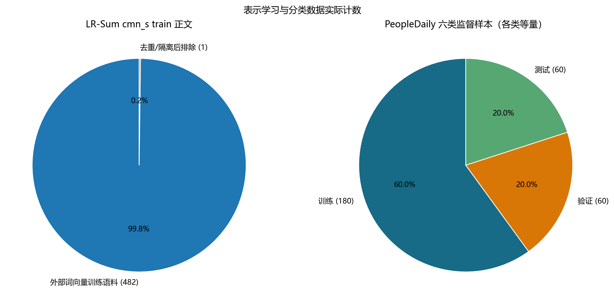
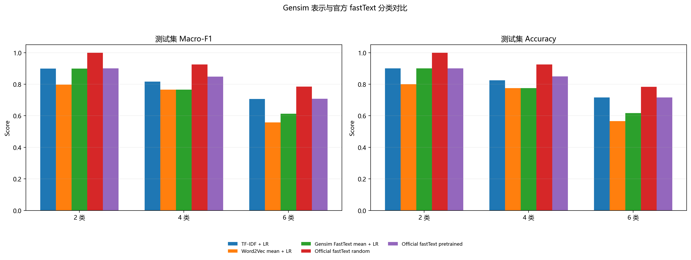
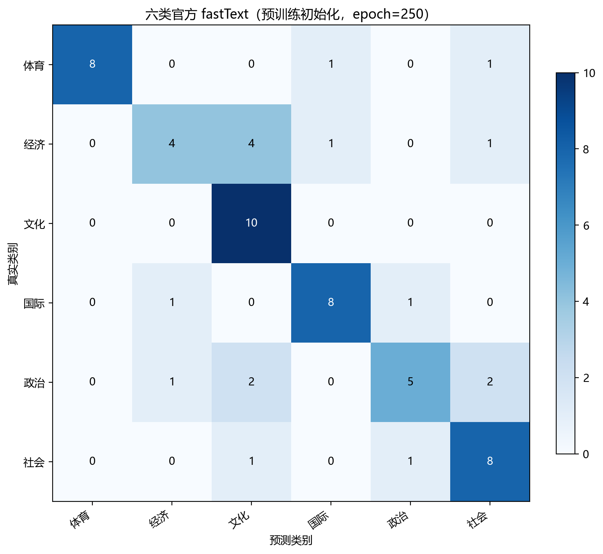

# Gensim 新闻表示学习与 fastText 文本分类实验

本次实验使用独立中文新闻语料训练 Gensim Word2Vec 与 FastText，再在人民日报 1998 年 1 月的固定样本上完成 2、4、6 类正文分类。比较包含 TF-IDF 基线、两种冻结词向量均值表示，以及官方 fastText 的随机初始化和预训练初始化；同时检查词近邻、未登录词、训练词表覆盖和分类错误。六类测试中，官方 fastText 随机初始化的 Accuracy / Macro-F1 为 0.7833 / 0.7856，外部词向量初始化为 0.7167 / 0.7075。在本次小规模弱标签任务上，预训练初始化没有优于从头训练。

本次实验的代码及相关说明可在该仓库中获取：[LLMandAppliedPractices-Gensim-FastText](https://github.com/stq1234/LLMandAppliedPractices-Gensim-FastText)。仓库保存当前代码、原始外部语料、清洗数据、固定分类拆分、模型、逐篇预测、审计结果和报告。

## 1. 两种语料的用途与数据处理

### 1.1 独立新闻语料用于表示学习

表示学习使用 BLT Lab 的 [LR-Sum 数据集](https://huggingface.co/datasets/bltlab/lr-sum)，选取简体中文配置 `cmn_s` 的 `train` 分片，固定 revision 为 `deb2e73ce53e42ceda31297a991afa138ee665a8`。数据集收集新闻正文与摘要，本实验只使用正文 `text` 训练词向量，`id` 仅用于追踪来源；标题、摘要、URL 和标签不进入模型输入，也不使用该数据集的验证、测试分片。

下载的固定 Parquet 实际含 483 条记录。正文做 Unicode NFKC 规范化，移除控制字符并合并空白；用对大小写、空白和 Unicode 标点不敏感的正文指纹去重。去掉 1 条重复正文后，使用 jieba 0.42.1 分词并移除纯标点 token，最终得到 **482 篇、359,302 个词**。原始文件、清洗正文、分词语料和逐篇纳入/排除清单均已保存，计数以本次实际读取的文件为准。

LR-Sum 数据集卡标注 [CC BY 4.0](https://creativecommons.org/licenses/by/4.0/)。本实验对原数据进行了规范化、去重和分词；数据归属 LR-Sum / BLT Lab，相关论文为 Palen-Michel 与 Lignos（2023）的 [LR-Sum: Summarization for Less-Resourced Languages](https://aclanthology.org/2023.findings-acl.427/)。固定下载链接、许可、修改说明和原始文件 SHA-256 见 `data/SOURCE.md`。

### 1.2 人民日报用于固定弱标签分类

分类使用本地 `作业1.3_ngram编程实验/data/人民日报1998_PFR.zip` 中的 `199801/199801.txt`。一月共 31 天、19,484 条非空记录，按日期、版面、文章编号合并为 3,148 篇文章。原数据已有词级分词和词性标注，因此直接解析 `词/POS`，去掉词性、实体方括号和 `/w` 标点，得到 947,665 个非标点词。标题取 `001` 段，正文取其余段。一个段号重复出现但正文不同，清洗时按源顺序保留两条，避免覆盖。

原语料没有本实验的主题金标准，故按标题中的精确分词关键词构造弱标签。例如“足球/球队”对应体育，“经济/银行/企业”对应经济，“电影/文学/艺术”对应文化；国际类使用外国国名、联合国和外交词，政治类使用核心政治机构与制度词，社会类涵盖广义民生。完整规则保存于 `data/selection_rules.json`。正文至少 80 词，同类可命中多个词，跨类命中的标题排除。标签反映标题规则判断，不能当作人工确认的正文主题。

| 类别 | 六类规则下候选数 | 选取数 | 训练 | 验证 | 测试 |
| --- | ---: | ---: | ---: | ---: | ---: |
| 体育 | 50 | 50 | 30 | 10 | 10 |
| 经济 | 192 | 50 | 30 | 10 | 10 |
| 文化 | 70 | 50 | 30 | 10 | 10 |
| 国际 | 124 | 50 | 30 | 10 | 10 |
| 政治 | 71 | 50 | 30 | 10 | 10 |
| 社会 | 113 | 50 | 30 | 10 | 10 |

按 `SHA256("20261009:select:" + article_id)` 排序，每类选 50 篇，再用独立的 `split` 盐值哈希分成 30/10/10。2 类使用体育、经济；4 类加入文化、国际；6 类再加入政治、社会。三个任务共享对应类别的文章与拆分，训练/验证/测试数依次为 60/20/20、120/40/40、180/60/60。分类统一输入正文前 500 个已有分词，不输入生成弱标签的标题。

### 1.3 输入隔离与分词差异

Gensim 表示学习只读取 LR-Sum 正文，人民日报仅用于分类和来源交叉检查。对外部正文与全部 3,148 篇人民日报正文进行相同指纹规范化后，全文相同和前 200 字符相同的记录均为 0；与分类验证、测试正文的这两项匹配也均为 0。该检查排除了所定义的完全/前缀重复，不能证明不存在语义近重复。TF-IDF 词表和向量标准化参数均只在监督训练集拟合。

人民日报保留源文件人工分词，LR-Sum 使用 jieba，两个语料也存在领域和年代差异。因此，外部词向量即使训练成功，仍需检查能覆盖多少分类词。分类候选、规则和拆分保持冻结，并记录 SHA-256；表示学习输入由独立语料生成，避免让验证、测试文章直接参与词向量训练。



图 1：左图为外部表示学习语料的实际保留/排除数（482/1）；右图为六类分类样本的训练/验证/测试数（180/60/60）。类别均衡来自选样，不能据此推断原始人民日报主题分布。

## 2. 表示学习、初始化与验证选模

Gensim Word2Vec 和 FastText 均使用 Skip-gram、100 维、窗口 5、`min_count=3`、10 epoch、单 worker、seed=42，入口设置 `PYTHONHASHSEED=0`。FastText 额外使用长度 2—4 的字符 n-gram 和 100,000 个哈希桶。两者的显式词表均为 **11,171 词**。

| 方法 | 文本表示与训练方式 |
| --- | --- |
| TF-IDF + LR | unigram、sublinear TF-IDF 后训练逻辑回归 |
| Word2Vec mean + LR | 正文词向量均值，词表外词跳过；训练集 StandardScaler 后接逻辑回归 |
| Gensim FastText mean + LR | 正文词向量均值，词表外词可由字符子词组合；同样标准化后接逻辑回归 |
| 官方 fastText，随机初始化 | `fasttext.train_supervised` 联合学习文本特征与标签预测 |
| 官方 fastText，预训练初始化 | 用 Gensim FastText 导出的 `.vec` 初始化，再执行相同监督训练 |

LR 固定 `C=1`、`max_iter=2000`。官方 fastText 使用 100 维、学习率 0.5、`wordNgrams=2`、`minn=maxn=0`、softmax、thread=1、bucket=100000、seed=42。监督实验保留词二元组，但关闭字符子词；这里的词 n-gram 与 Gensim FastText 的字符 n-gram 是两种特征，不能混为一谈。

六类监督训练正文共有 9,313 个不同词、52,198 次词出现。两个 Gensim 模型的显式词表覆盖其中 3,975 个词和 41,039 次出现，类型覆盖率为 **42.68%**，词频加权覆盖率为 **78.62%**。这衡量显式词表覆盖；Gensim FastText 对部分词表外词仍能组合向量，不能把 42.68% 理解为其全部向量可用率。

预训练 `.vec` 只导出“六类监督训练词表 ∩ Gensim FastText 的 `key_to_index`”中的 **3,975 词**，供三个嵌套任务使用；未导出验证/测试专有词和合成 OOV 向量。文件传递的是整词与子词组合后的词向量，不包含完整字符桶权重，因而不等于迁移 Gensim 的全部子词机制。初始化向量还会接受监督更新。

每个任务、每种官方 fastText 初始化方式均比较预先确定的 25、100、250 epoch，只按验证集 Macro-F1 选择，平局取较小轮数，再评估所选模型的测试集。完整 18 条候选记录保存在 `results/fasttext_validation_curve.csv`。

| 类别数 | 随机初始化所选 epoch | 验证 Macro-F1 | 预训练所选 epoch | 验证 Macro-F1 |
| --- | ---: | ---: | ---: | ---: |
| 2 | 100 | 1.0000 | 25 | 1.0000 |
| 4 | 250 | 0.9260 | 250 | 0.8496 |
| 6 | 250 | 0.7107 | 250 | 0.7032 |

两类预训练三个候选的验证分数相同，所以选 25；这只体现验证选模规则，不表示其测试分数最大。测试集未参与 epoch 选择。

## 3. 分类结果及其解释

每格为测试集 **Accuracy / Macro-F1**。Accuracy 是预测正确比例，Macro-F1 是各类别 F1 的等权平均。2、4、6 类测试样本分别为 20、40、60 篇。

| 方法 | 2 类 | 4 类 | 6 类 |
| --- | --- | --- | --- |
| TF-IDF + LR | 0.9000 / 0.8990 | 0.8250 / 0.8172 | 0.7167 / 0.7066 |
| Word2Vec mean + LR | 0.8000 / 0.7980 | 0.7750 / 0.7652 | 0.5667 / 0.5579 |
| Gensim FastText mean + LR | 0.9000 / 0.8990 | 0.7750 / 0.7661 | 0.6167 / 0.6137 |
| 官方 fastText，随机初始化 | 1.0000 / 1.0000 | 0.9250 / 0.9246 | 0.7833 / 0.7856 |
| 官方 fastText，预训练初始化 | 0.9000 / 0.9000 | 0.8500 / 0.8487 | 0.7167 / 0.7075 |



图 2：各任务所选模型的测试 Macro-F1 与 Accuracy，柱高来自逐篇实际预测。图中 FastText(mean) 是 Gensim 冻结表示，官方 fastText 两组则使用监督训练。

本次官方 fastText 随机初始化在三个测试任务上均最高。六类中，Gensim FastText 均值比 Word2Vec 均值高约 0.0557 Macro-F1，但两者都低于 TF-IDF。外部表示能返回稠密向量，并不必然比稀疏词特征更适合当前主题标签；均值还会丢失词序、局部搭配和词的重要性。官方分类器针对标签更新表示，并使用词二元组，这组比较同时改变了特征与训练目标，不能把优势全部归因于某一个因素。

外部词向量初始化没有超过随机初始化。较低的显式词表覆盖、语料领域与年代差异、分词边界差异，都是解释这一结果的合理候选；本实验没有分别控制这些因素，不能确认其中哪一项是主要原因，也不能推断预训练在其他任务中无效。字符桶没有迁移、监督阶段关闭字符子词，也限定了这里“预训练”的具体含义。

全部方法的训练 Accuracy 为 1.0，而多类验证、测试表现下降，训练拟合并不代表泛化。两类 20 篇全部正确只是一组固定样本的观察。每类测试只有 10 篇，单次种子不足以支持稳定优劣或统计显著性；增加类别数时样本总数也变化，因此这不是只改变类别数的严格因果比较。

## 4. 词近邻、OOV 与分类错误

### 4.1 从可查询性到语义质量

查询“经济”“银行”“足球”“文化”，得到如下实际近邻（余弦相似度）：

| 查询词 | Word2Vec 示例 | Gensim FastText 示例 |
| --- | --- | --- |
| 经济 | 增长 0.6207；复苏 0.6205 | 经济舱 0.8915；经济繁荣 0.8493 |
| 银行 | 荷兰 0.9107；金属 0.9055 | 投资银行 0.9112；投行 0.8803 |
| 足球 | 不在显式词表，无法返回向量 | 不在显式词表，可组合向量；墨尔本 0.9542 |
| 文化 | 语言 0.7922；特色 0.7686 | 文化交流 0.8756；语言 0.8378 |

FastText 的“经济舱”与“经济”共享字串，但词义并不相同；“足球”的组合向量近邻也未呈现清晰体育语义。Word2Vec 的“银行”近邻同样不符合直觉，说明当前小语料中的分布信息仍有局限。近邻检查能诊断表示行为，不能替代标准语义相似性评测。

另固定查询三个未出现在显式词表中的组合词：

| OOV 查询 | 在 `key_to_index` 中 | 可返回向量 | 向量范数 | 最近邻示例 |
| --- | --- | --- | ---: | --- |
| 数字农业实验室 | 否 | 是 | 1.4020 | 实验室 0.9427 |
| 星际体育学院 | 否 | 是 | 1.0230 | 商学院 0.9273 |
| 云端金融平台 | 否 | 是 | 0.9593 | 复航 0.9242 |

这些查询验证了字符子词组合可以生成非零向量；第三个近邻明显不符合预期，“能合成向量”与“正确理解新词”仍是两回事。子词共享、有限训练语料和哈希碰撞都可能影响表示，本实验未通过消融判断这些因素的具体贡献。

### 4.2 六类混淆与弱标签边界



图 3：六类官方 fastText 预训练初始化、250 epoch 模型的测试混淆矩阵。行是真实弱标签，列是预测；每行 10 篇，共 60 篇，正确 43 篇、错误 17 篇。

文化类 10/10 正确，经济类仅 4/10，其中 4 篇预测为文化；政治类 5/10。查看错误清单并阅读对应正文，有些混淆反映了主题交叉与标题规则的局限：

- `19980124-08-005`《莫斯科申办夏季奥运会》弱标签为体育、预测为国际，正文同时包含莫斯科、国际奥委会和国外消息来源，兼有国际新闻特征。
- `19980117-05-007`《转型期中国经济关系研究》弱标签为经济、预测为文化，正文是经济理论书籍的出版介绍与评论，具有图书文化主题。
- `19980124-10-007`《树立企业形象的需要》弱标签为经济、预测为文化，正文主要讨论京剧以及企业支持文艺，标题中的“企业”未必代表正文主主题。

这些是相对于弱标签的预测差异，不能逐项视为真实主题错误，也不能据少数案例免除其余模型错误。后续应人工核验一批正文标签，考虑多主题标注或更清晰的社会类边界，并在不同日期、更多样本和多个随机种子上复验。

## 5. 论文、实现与参数对照

阅读并对照 [Enriching Word Vectors with Subword Information](https://aclanthology.org/Q17-1010/) 与 [Bag of Tricks for Efficient Text Classification](https://aclanthology.org/E17-2068/)，同时查看本机 Gensim 4.3.3 的 `models/word2vec.py`、`models/fasttext.py` 和 fasttext-wheel 0.9.2 的 `fasttext/FastText.py` 包装层。

Gensim 的 `build_vocab` 建立词频与索引，`train` 执行表示学习。FastText 的 `_do_train_job` 将批次交给 `train_batch_any`；`FastTextKeyedVectors.adjust_vectors` 组合整词向量与字符 n-gram 桶向量，`get_vector` 对词表外词用 `ft_ngram_hashes` 获得子词桶并求平均。这与论文让字符片段跨词共享表示的核心思想对应，也解释了为什么 `key_to_index` 中没有某个词，仍可能得到向量。

`min_count` 控制显式词表低频过滤，`min_n/max_n` 控制字符片段长度，`bucket` 决定哈希桶规模并影响内存与碰撞。字符片段较短可能带来更多共享，也可能把词义不同的词联系起来；增加桶数不能自动解决语义质量问题。100 维、窗口 5、10 epoch 是本实验的规模选择，并非已验证的最佳超参数。

官方 `train_supervised` 的 Python 包装层设置监督模式与参数，再调用原生 fastText 训练。本实验使用这一 API 完成分类；Gensim FastText 用于无监督词表示。分类论文通过词及词 n-gram 特征形成文本表示并预测标签，本实验开启二元组、使用 softmax；没有评测论文用于大量标签的层次 softmax 加速。学习率与 epoch 决定监督更新强度，预训练改变初值，仍需靠验证与测试判断效果。

在当前 Windows 中文工作目录中，官方绑定对训练文本、`.vec` 与 `.bin` 的中文路径读写失败。脚本把相关原生读写放在英文临时目录，完成后把应保留的模型复制回项目并清理临时输入，数据内容仍为 UTF-8 中文。该处理已支持本次完整分类流程运行。

## 6. 复现、耗时与结果核验

环境为 Python 3.12.7、Gensim 4.3.3、fasttext-wheel 0.9.2、NumPy 1.26.4、SciPy 1.13.1、scikit-learn 1.5.1、matplotlib 3.9.2、jieba 0.42.1、PyArrow 22.0.0。在仓库根目录执行：

```powershell
python -m pip install -r requirements.txt
python run_experiment.py
python audit.py
```

入口根据保存的外部原始 Parquet 重建清洗与分词语料。来源 revision 或语料摘要不匹配时重新训练表示模型；匹配时载入检查点，载入失败或核验失败则退出并报告错误。监督分类、验证选模和结果输出每次重跑。仓库包含当前所需的冻结人民日报清洗与分类数据，运行不依赖原始完整 ZIP。`README.md` 提供文件说明与强制重新训练的方法。

两个外部语料表示模型首次训练记录分别为 Word2Vec 1126.21 秒、Gensim FastText 374.46 秒。最终核验运行加载了通过检查的模型，外部预处理约 3.85 秒，表示加载及诊断约 0.41 秒，全部分类候选约 34.56 秒。表示训练时的底层线程环境未记录，分类阶段记录了 OMP、OpenBLAS、MKL 各 1 线程；这些是本机阶段耗时，不能混合为重新训练总耗时或据此建立算法速度结论。

独立审计状态为 **PASS**：从原始外部文件重建 483→482 篇及 359,302 词，核验分类冻结文件摘要、300 篇选样、嵌套拆分、输入截断和语料隔离；载入检查点核对参数与 482 篇训练语料计数；检查 `.vec` 的 3,975 行均为正确维度、无零向量；从 3,000 条逐篇预测复算 45 组训练/验证/测试指标，并核对验证选模和六类混淆矩阵的 60 篇、17 条错误。三幅正文图均来自这些实际数据。实验结论限于本次独立新闻表示、固定弱标签样本和单次种子的比较。
